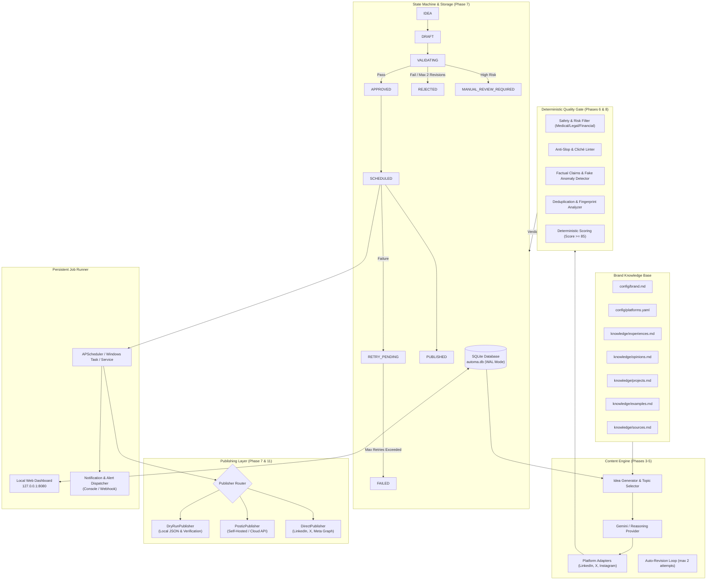

# Automa — Autonomous, High-Quality Social Media Publishing System

> **A reliable, low-cost, mostly autonomous social media content engine for your personal brand.**  
> Automa generates original, substantive, platform-tailored engineering content and publishes to **LinkedIn**, **X (Twitter)**, and **Instagram** without requiring daily commands or manual post-by-post babysitting.

---

## 🌟 Key Features

1. **Zero AI Slop**: Enforces a strict, deterministic quality gate that rejects clichés ("delve", "game-changer", "supercharge", "unleash"), empty motivational quotes, fake personal revenue anecdotes, and exaggerated claims.
2. **Deterministic Quality Gate & Scoring**: Evaluates every draft from 0 to 100 with mandatory checks (score $\ge 85$ required). Automatically triggers up to two targeted revisions before rejecting.
3. **Autonomous Safety Policy (Phase 8)**: Automatically publishes routine, low-risk, brand-aligned posts while routing high-stakes topics (financial/investment advice, medical claims, legal disputes, political endorsements, confidential data) to `MANUAL_REVIEW_REQUIRED`.
4. **Persistent Queue State Machine**: Full SQLite WAL storage tracking `IDEA` $\rightarrow$ `DRAFT` $\rightarrow$ `VALIDATING` $\rightarrow$ `APPROVED` $\rightarrow$ `SCHEDULED` $\rightarrow$ `PUBLISHED`, plus `REJECTED`, `FAILED`, `RETRY_PENDING`, and `MANUAL_REVIEW_REQUIRED`.
5. **Deduplication & Originality**: Uses SHA-256 normalized content fingerprinting and word-level Jaccard similarity to prevent duplicate posts or recycled ideas disguised with minor rewording.
6. **Pluggable Multi-Platform Publishing**:
   - **Postiz REST API**: Direct integration with Postiz self-hosted or cloud (`POST /public/v1/posts`).
   - **Direct APIs**: Extensible adapters for LinkedIn Community API, X (Twitter) API v2, and Instagram Graph API.
   - **Dry-Run Simulator**: Safe local verification saving full payload proofs to `content/published/*.json`.
7. **24/7 Standalone Background Daemon**: Built on **APScheduler** and persistent SQLite jobs with overdue recovery after system downtime. Runs completely independent of the Antigravity IDE. Includes ready-to-run Windows Task Scheduler automation.
8. **Localhost Monitoring Dashboard**: Sleek, responsive, dark-mode glassmorphism interface running on `http://127.0.0.1:8080` for inspecting queues, triggering generation runs, and reviewing flagged posts.

---

## 📐 System Architecture



---

## 🚀 Quick Start Guide

### 1. Prerequisites
- Python 3.10+ installed
- Git installed

### 2. Environment Setup
```bash
# Clone or navigate to the repository
cd f:\automa

# Create and activate virtual environment
python -m venv .venv
.\.venv\Scripts\activate

# Install dependencies
pip install -r requirements.txt
```

### 3. Configuration
Copy `.env.example` to `.env`:
```bash
copy .env.example .env
```
Open `.env` and configure your settings:
```ini
DRY_RUN=true                    # Keep true initially for safe dry-run simulation
ENVIRONMENT=development
TIMEZONE=UTC                    # Set to your preferred timezone (e.g. America/New_York)
GEMINI_API_KEY=your_key_here    # Google Gemini API key (from https://aistudio.google.com/app/apikey)
GEMINI_MODEL=gemini-2.5-flash
PUBLISHER_TYPE=dry_run          # Set to 'postiz' or 'direct' when ready for live publishing
POSTIZ_BASE_URL=https://api.postiz.com/public/v1
POSTIZ_API_KEY=your_postiz_key
```

### 4. Run Tests
Validate the entire deterministic gate, deduplication, retry, and safety policy:
```bash
.\.venv\Scripts\pytest.exe -v
```

---

## 🛠️ CLI Operations & Commands

Automa includes an operator CLI:

```bash
# Check queue counts, health, and recent posts
python -m automa.cli status

# Trigger an immediate content generation cycle
python -m automa.cli generate

# Check and publish due scheduled posts
python -m automa.cli publish

# Force-publish all scheduled posts immediately (useful during dry-run testing)
python -m automa.cli publish --force

# Inspect posts requiring manual review under safety policy
python -m automa.cli review

# Start the local monitoring web dashboard (http://127.0.0.1:8080)
python -m automa.cli web --port 8080

# Start the persistent scheduler daemon (runs 24/7)
python -m automa.cli daemon

# Generate Windows Task Scheduler background registration script
python -m automa.cli register-task
```

---

## 🖥️ Localhost Monitoring Dashboard

Automa includes a dark-theme, glassmorphism dashboard running strictly on `http://127.0.0.1:8080`:

1. Launch the server:
   ```bash
   python -m automa.cli web
   ```
2. Open your browser to `http://127.0.0.1:8080`.
3. View real-time queue states, click **Inspect** on any draft to view its deterministic score breakdown and fingerprint, or click **Generate New Posts** to trigger a run on demand.

---

## ⚙️ How to Run Autonomously (Without the IDE)

Automa does **not** rely on the Antigravity IDE being open. To set it up once and let it run permanently:

### Method 1: Windows Task Scheduler (Recommended on Windows)
1. Generate and inspect the registration script:
   ```bash
   python -m automa.cli register-task
   ```
2. Open PowerShell as Administrator and run:
   ```powershell
   powershell -ExecutionPolicy Bypass -File "f:\automa\register_windows_task.ps1"
   ```
3. Start the task:
   ```powershell
   Start-ScheduledTask -TaskName "AutomaBackgroundPublishingService"
   ```
   *The task is configured with `-AtLogon`, auto-restarts on failure, runs on battery or AC power, and will execute continuously in the background.*

### Method 2: Standalone Background Process / Service
Run the daemon process directly in a detached console, tmux/screen, or as an NSSM / systemd service:
```bash
python -m automa.cli daemon
```

---

## 🌐 Connecting Social Media Accounts

### Option A: Via Postiz (Recommended)
1. **Self-Hosted Postiz** (or Postiz Cloud at [postiz.com](https://postiz.com)).
2. Connect your social channels in the Postiz dashboard:
   - **LinkedIn**: OAuth sign-in to personal profile or company page.
   - **X (Twitter)**: OAuth 2.0 app authorization.
   - **Instagram**: Connect via Facebook Page linked to an Instagram Professional account.
3. In Postiz settings, copy:
   - Your **Public API Key** $\rightarrow$ `POSTIZ_API_KEY`
   - Integration IDs for each channel $\rightarrow$ `POSTIZ_LINKEDIN_INTEGRATION_ID`, `POSTIZ_X_INTEGRATION_ID`, `POSTIZ_INSTAGRAM_INTEGRATION_ID`.
4. In Automa `.env`, set:
   ```ini
   PUBLISHER_TYPE=postiz
   DRY_RUN=false
   ```

### Option B: Via Direct Official APIs
Set `PUBLISHER_TYPE=direct` and configure the official credentials in `.env`:
- **LinkedIn**: Developer portal access token + Member Person URN (`urn:li:person:...`).
- **X**: Developer Portal Free or Basic v2 API keys (`X_API_KEY`, `X_API_SECRET`, `X_ACCESS_TOKEN`, `X_ACCESS_SECRET`).
- **Instagram**: Meta for Developers App $\rightarrow$ Instagram Graph API token + Instagram Account ID.

---

## 💰 Cost Breakdown & API Quotas

| Service / Resource | Monthly Cost | Cost Controls Enforced |
| :--- | :--- | :--- |
| **Gemini API** | **$0.05 – $0.50 / mo** | 3–5 posts/week conservative cap; max 2 auto-revisions; token output capped at 2,048 tokens. |
| **Postiz** | **$0.00** (self-hosted) | Free and open source; uses official public REST endpoints. |
| **LinkedIn API** | **$0.00** | Free official API access. Rate limit: 100 posts/day (well above our target). |
| **X (Twitter) API** | **$0.00** (Free v2 or Postiz) | Character limits strictly enforced (280 chars single / 5 tweets max thread). |
| **Instagram Graph** | **$0.00** | Meta Graph API for Instagram Professional is free. |
| **Compute / Storage** | **$0.00** | Runs locally on your machine / server with embedded SQLite WAL storage. |

---

## 🔒 Security & Privacy Practices

- **Zero Scraping & Zero Browser Automation**: All posting uses official APIs or Postiz endpoints. No fragile browser automation, no unauthorized reverse-engineered endpoints.
- **Strict Secret Scrubbing**: All logs and notification dispatches pass through `automa.notifications.scrubber.SecretScrubber`, automatically stripping API keys, tokens, and passwords before writing to disk or sending webhooks.
- **Localhost Isolation**: The web dashboard is bound strictly to `127.0.0.1` and will not bind to `0.0.0.0`.
- **Git Protection**: `.env`, `*.db`, `logs/*.log`, and `content/published/*` are pre-configured in `.gitignore`.

---

## 📁 Repository Structure

```
f:\automa\
├── .env.example               # Secrets and configuration template
├── .gitignore                 # Excludes database, virtualenv, logs, and credentials
├── requirements.txt           # Pinned production dependencies
├── pytest.ini                 # Test runner configuration
├── register_windows_task.ps1  # Automated Windows background task installer
├── README.md                  # Comprehensive user and operator guide
├── config/
│   ├── brand.md               # Editable personal brand boundaries, tone, prohibited topics
│   └── platforms.yaml         # Platform constraints, schedules, and style guidelines
├── knowledge/                 # Verified factual foundation (no hallucinations)
│   ├── experiences.md         # Documented technical post-mortems and lessons
│   ├── opinions.md            # Defensible, grounded architectural perspectives
│   ├── projects.md            # Verified project architectures and technical artifacts
│   ├── examples.md            # Concrete code patterns and implementation blueprints
│   └── sources.md             # Verified RFCs, papers, and official documentation
├── content/
│   ├── queue/                 # Active post payloads and media asset specs
│   ├── published/             # Permanent publication artifacts and verification proofs
│   └── rejected/              # Rejected drafts with gate audit reports
├── logs/                      # Audit trails and execution logs
├── data/                      # Persistent SQLite storage (WAL mode)
│   └── automa.db
├── automa/
│   ├── config.py              # Configuration & knowledge base loader
│   ├── cli.py                 # Operator command-line interface
│   ├── db/
│   │   ├── schema.py          # SQLite schema & WAL connection manager
│   │   └── repository.py      # Relational repository & queue state transitions
│   ├── engine/
│   │   ├── generator.py       # Topic selection, drafting, and auto-revision
│   │   └── providers.py       # GeminiProvider & MockProvider
│   ├── gate/
│   │   ├── quality_gate.py    # Deterministic scoring (0-100) & revision orchestrator
│   │   ├── rules.py           # Anti-slop filters, cliché & fake anecdote linters
│   │   └── safety.py          # Autonomous safety policy (medical/financial/legal)
│   ├── publishers/
│   │   ├── base.py            # Publisher interface & result schemas
│   │   ├── dry_run.py         # Dry-run simulator & artifact generator
│   │   ├── postiz.py          # Postiz REST API client
│   │   └── direct.py          # Direct official social API adapters
│   ├── scheduler/
│   │   ├── runner.py          # APScheduler daemon, retry backoff, overdue recovery
│   │   └── windows_task.py    # Windows Task Scheduler registration script generator
│   ├── notifications/
│   │   ├── notifier.py        # Actionable alert router & digest generator
│   │   └── scrubber.py        # Sensitive secret & token scrubber
│   └── web/
│       ├── server.py          # Localhost HTTP dashboard server
│       └── static/            # Dark-theme obsidian glass interface
│           ├── index.html
│           ├── styles.css
│           └── app.js
└── tests/
    ├── test_quality_gate.py   # Anti-slop, cliché, and scoring tests
    ├── test_deduplication.py  # Fingerprint & similarity tests
    ├── test_safety.py         # High-stakes safety policy tests
    ├── test_publisher.py      # Dry-run & secret scrubber tests
    └── test_scheduler.py      # Queue transitions & recovery tests
```
